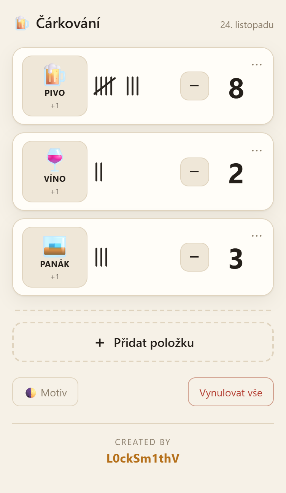

# 🍺 Čárkovací počítadlo

Jednoduchá webová appka (PWA) pro hospodu — **čárkování** vypitých drinků a snědeného jídla.
Ťukneš na ikonu položky, přibude ručně kreslená čárka (卌) a zvýší se počet. Žádné peníze, jen počty kousků.

## Náhled

  

## Funkce
- Čárkování po pěti jako na pivním tácku, vedle velké souhrnné číslo
- Přidání položky (+1) ťuknutím na ikonu, tlačítko **−** ubere
- Úprava řádku přes **⋯** — přejmenovat, přepsat přesný počet, smazat
- Vlastní položky (např. Becherovka)
- Vše se ukládá v telefonu, funguje **offline**
- Instalovatelné na plochu jako aplikace (vlastní ikona, běh na celou obrazovku)
- Světlý i tmavý motiv

## Spuštění
Otevři `index.html` v prohlížeči, nebo použij hostovanou verzi přes **GitHub Pages**:

👉 **https://l0cksm1thv.github.io/hospodske-carkovani/**

## Přidání na plochu (jako aplikace)

Appku si můžeš nainstalovat na plochu telefonu — pak se spouští na celou
obrazovku bez lišty prohlížeče, s vlastní ikonou a funguje i offline.

### 📱 Android (Chrome)
1. Otevři v prohlížeči **Chrome**: https://l0cksm1thv.github.io/hospodske-carkovani/
2. Klepni na menu **⋮** (tři tečky vpravo nahoře)
3. Vyber **„Přidat na plochu"** (nebo „Nainstalovat aplikaci")
4. Potvrď **„Přidat"**

### 🍏 iPhone / iPad (Safari)
Na iOS to funguje **jen přes Safari** (ne přes Chrome).
1. Otevři v **Safari**: https://l0cksm1thv.github.io/hospodske-carkovani/
2. Klepni na ikonu **Sdílet** (čtvereček se šipkou nahoru, dole uprostřed)
3. Sjeď dolů a vyber **„Přidat na plochu"**
4. Potvrď **„Přidat"** vpravo nahoře

> **Pozn.:** Počty se ukládají přímo v telefonu. Na iOS může Safari uložená data
> smazat, pokud appku hodně dlouho vůbec neotevřeš — při běžném používání se to nestane.

## Technologie
Čisté HTML, CSS a JavaScript — bez frameworků a bez závislostí.
Ukládání přes `localStorage`, offline přes service worker (`sw.js`).

## Autor
**L0ckSm1thV**
